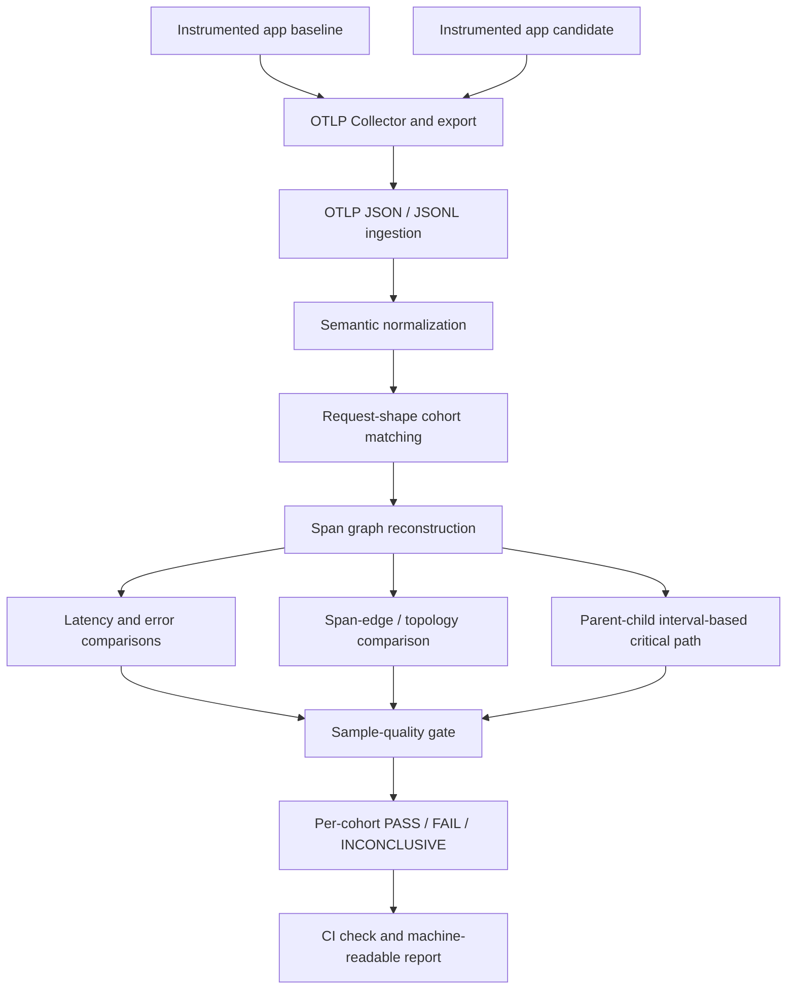

# DetTrace: architecture, regression methodology, and evidence

**What it is:** a CI-oriented comparator for **baseline** versus **candidate** OpenTelemetry traces.  
**Primary aim:** catch request-specific performance, error-rate, and span-graph changes without allowing healthy traffic to mask a degraded endpoint.  
**Canonical README:** [repository root](../README.md) · **External validation:** [Astronomy Shop](ASTRONOMY_SHOP_VALIDATION.md)

> This document describes the currently documented experiments and algorithmic boundaries. These are controlled regression experiments, not production incident statistics or a formal verification of arbitrary distributed causality.

## The motivating failure

An application serves both `/checkout` and `/health`. If most traffic is healthy health checks, a global latency aggregate might look acceptable while the checkout flow degrades. DetTrace instead matches **like with like**: it groups the traces by a request-shape fingerprint, then evaluates each cohort separately.

The documented fingerprint includes the root service, root span operation, and HTTP method/route. Each cohort receives its own comparison and quality decision.

## Data flow



**Implementation areas shown in the public repository:**

- `trace_regression/`: normalization, graph analysis, cohort comparison, critical-path logic, and CLI.
- `demo_checkout/`: an instrumented checkout example with baseline and candidate executions.
- `otel/`: OpenTelemetry Collector configuration.
- `artifacts/otlp/`: recorded Collector-output comparison artifacts.
- `docs/ASTRONOMY_SHOP_VALIDATION.md`: independent controlled validation against Astronomy Shop.
- Root `action.yml`: composite GitHub Action entry point.

These are **architectural roles**, not a claim that every subdirectory implements a separate deployed microservice.

## How to reproduce the documented checkout comparison

From a repository checkout with its Python dependencies installed:

```bash
python3 -m trace_regression.cli \
  --baseline artifacts/otlp/baseline.otlp.jsonl \
  --candidate artifacts/otlp/candidate.otlp.jsonl \
  --regression-threshold-pct 50 \
  --error-threshold-pp 5
```

The README states the Collector-backed artifacts contain **40 traces per side**, with the example breaking out `POST /checkout` at **30 baseline / 30 candidate** and `GET /health` at **10 baseline / 10 candidate**. The health cohort is below the **30-per-side** minimum in that example, so a nominal raw `PASS` is surfaced as **INCONCLUSIVE** rather than an authoritative pass.

### Results documented for the injected checkout regression

| Signal | Baseline | Candidate | Interpretation |
|---|---:|---:|---|
| `POST /checkout` p95 | 43.04 ms | 141.30 ms | +228.3% p95 regression |
| `POST /checkout` error rate | 0% | 20% | +20 percentage points (pp) |
| `inventory.reserve -> redis.lookup` | Absent | Present | New span-graph dependency edge |
| `inventory.reserve` p95 contribution | — | +59.22 ms | A reported candidate-localization signal, **not** an additive decomposition of total p95 |
| `GET /health` cohort size | 10 | 10 | Reported `INCONCLUSIVE` with the documented quality minimum |

A 20-percentage-point error increase must not be described as a “20% relative increase” starting from zero. Likewise, span p95 changes are not additive components of the end-to-end p95.

## OpenTelemetry Collector and CI boundaries

The documented integration path is instrumented application **-> OTLP/gRPC -> Collector -> OTLP JSON -> DetTrace ingestion**. That demonstrates compatibility with Collector-produced traces, not only a homegrown in-memory trace generator.

The root README also describes a reusable composite GitHub Action. To pin that action in another project, use an **existing published tag or immutable commit SHA**, verifying it actually exists before adopting an example such as `@v1`.

This is a **comparison gate**, not a performance benchmark harness that automatically guarantees identical CPU load, service dependencies, or deployment conditions across captures. Experiment controls matter.

## Astronomy Shop external validation (controlled workload)

The [Astronomy Shop validation notes](ASTRONOMY_SHOP_VALIDATION.md) pin upstream commit `8c47d47c9ac27710d2b2a153bcd53e483bffe66d` and document 40-request, single-worker captures:

1. **Injected shipping delay:** an intentional ~1-second delay in international shipping changed `shipping / POST /ship-order` p95 from **24.00 ms to 1,015.23 ms**; the request remained functionally successful and the comparison returned `FAIL`.
2. **Topology perturbation:** an extra `GetCart` RPC made a relevant edge's multiplicity change from **1 to 2**, without changing the checkout response used.
3. **Request-specific errors:** a payment failure feature flag was enabled in a controlled scenario while unrelated fault flags were disabled.

These are **deliberately introduced** candidate changes. They should never be described as actual failures found in an externally operated production system.

## Correctness boundaries and limitations

- **Parent-child span timing is not arbitrary causal inference.** The critical-path analysis is interval-derived for tree-structured timing; it does not claim a complete happens-before DAG across arbitrary async dependencies.
- **Percentiles are not additive.** P95 of a sum is generally not the sum of component p95s; treat contributor ranking as diagnostic evidence rather than an accounting identity.
- **Sampling matters.** A small or biased trace cohort may be `INCONCLUSIVE`; a PASS is not evidence of non-regression under all workloads.
- **Semantic matching matters.** Route naming, service naming, and instrumentation changes may create misleading cohort mismatches; inspect fingerprints and trace counts.
- **Topology alone is not causality.** A new edge is a changed observed span relationship. It does not by itself establish why latency rose.
- **CI decisions need stable experimental controls.** Re-run controlled captures if ambient load, collector drops, or sampling differs across versions.

## Debugging a failed comparison

1. Check that baseline and candidate artifacts came from comparable workloads and Collector configs.
2. Inspect cohorts and trace counts. If under threshold, retain `INCONCLUSIVE`; do not relabel as pass.
3. Compare p95 and error **per request fingerprint**, not aggregate across endpoints.
4. Inspect new/missing edges and the reported critical-path contributor for localization.
5. Verify the candidate change (e.g., injected delay) against the instrumented application code; avoid declaring causation solely from telemetry.
6. Preserve raw OTLP artifacts and output reports so reviewers can reproduce the run.

## Why this design

Cohort matching protects against Simpson's-paradox-like masking by traffic mix. Conservative quality gates avoid declaring confidence on insufficient evidence. The graph and critical-path layers provide an explanation of **where the signal appears** rather than reporting a single unexplained percentage.

**What is proved here:** the published artifacts and documented experiments demonstrate detection of specifically injected regressions under controlled conditions. They do **not** certify broad production reliability or universal algorithmic correctness.
